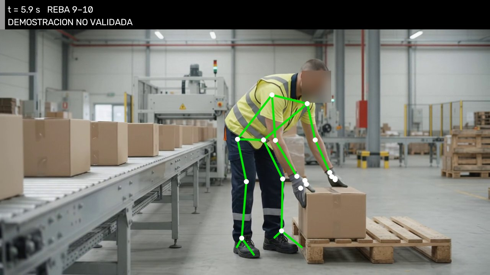
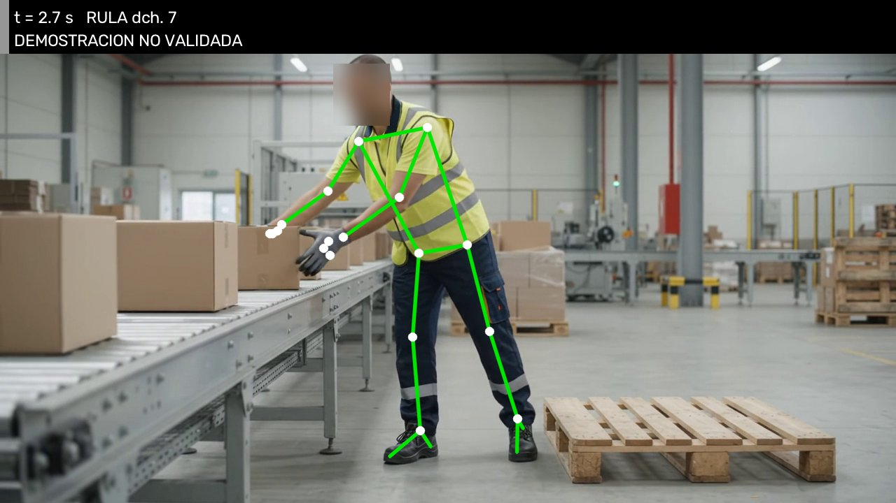
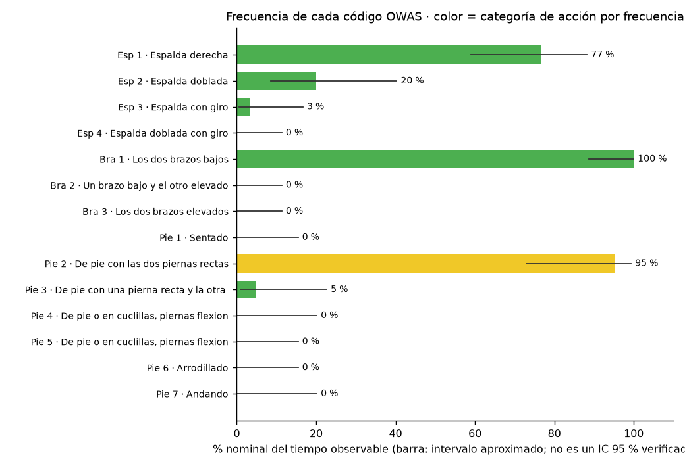
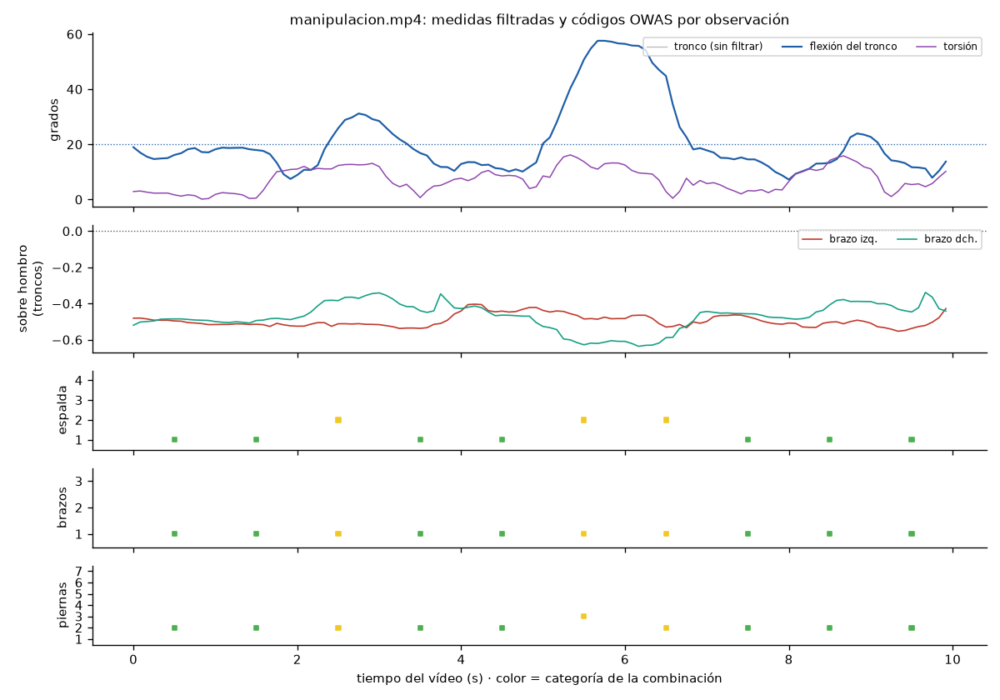
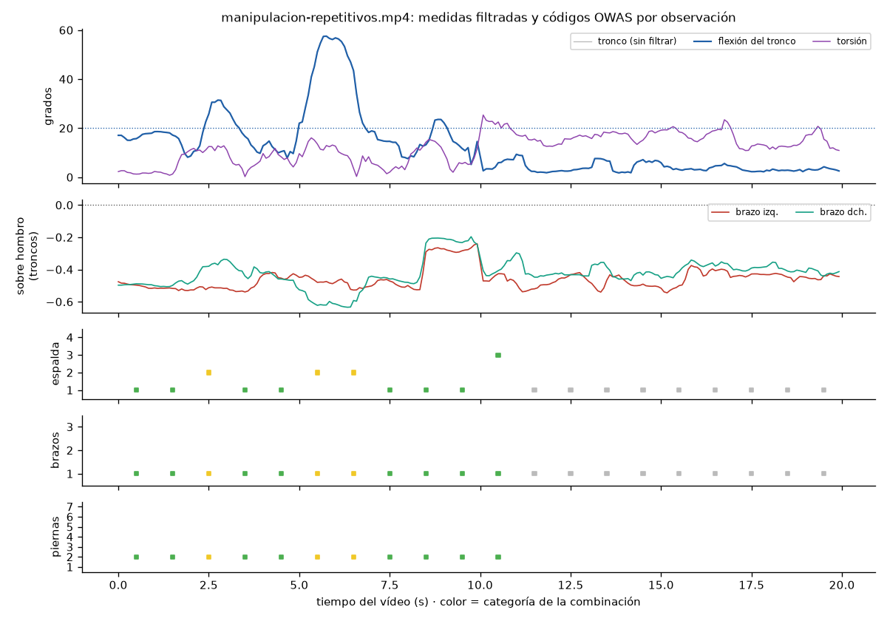
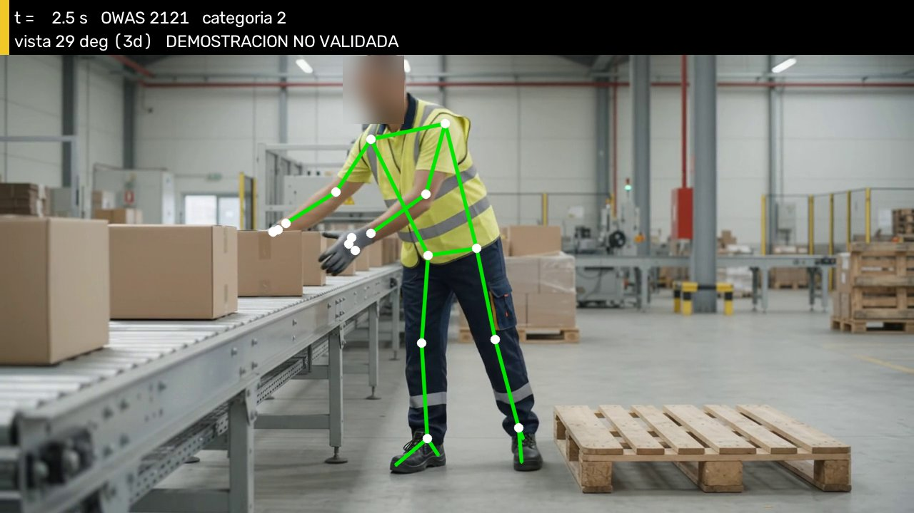
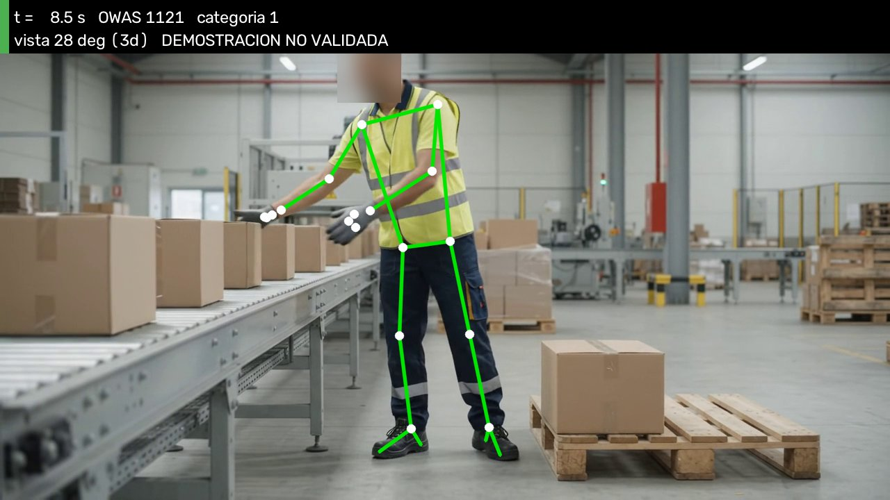

# Estudio ergonómico a partir de vídeo: OWAS, REBA, RULA

> **Demostración no validada.** Las posturas salen de un modelo de visión artificial (MediaPipe Pose) aplicado a vídeo de una sola cámara por toma, con reglas y umbrales que no se han contrastado con observaciones de un ergónomo. Este informe no sustituye a una evaluación de riesgos ni al criterio de un técnico de prevención.

Generado el 06/11/2026 12:07 con la skill *estudio-ergonomico-video* (MediaPipe Pose, modelo «full»).

## Resumen

**Cómo leer este informe.** Las puntuaciones se calculan con reglas y tablas en código. Cada ángulo lleva un margen de medida provisional; si el margen cruza un umbral, o falta un dato (no se ve o no se ha declarado), la puntuación se da como **rango**. Lo desconocido nunca se sustituye por el valor favorable. Los semáforos miden cobertura y certeza del cálculo, no la exactitud de la medida.

| Método | Qué evalúa | Vídeo | Validez técnica (provisional) | Por qué |
|---|---|---|---|---|
| OWAS | % del tiempo observable en cada postura | todos | 🟠 | intervalo aproximado del % de tiempo de ±16 puntos; grabación de 30 s (OWAS pide 20–40 min); piernas: código nominal conocido en el 70 % de las observaciones |
| REBA | peor postura (dos lados) | manipulacion.mp4 | 🟢 | Rango 9–10 dentro del mismo nivel de actuación. |
| RULA | peor postura, lado izq. | manipulacion.mp4 | 🟢 | peor postura visible, medida y acotada |
| RULA | peor postura, lado dch. | manipulacion.mp4 | 🟢 | peor postura visible, medida y acotada |
| REBA | peor postura (dos lados) | manipulacion-repetitivos.mp4 | 🟢 | Rango 9–10 dentro del mismo nivel de actuación. |
| RULA | peor postura, lado izq. | manipulacion-repetitivos.mp4 | 🟢 | peor postura visible, medida y acotada |
| RULA | peor postura, lado dch. | manipulacion-repetitivos.mp4 | 🟢 | peor postura visible, medida y acotada |

- **REBA · manipulacion.mp4:** peor postura sostenida **9–10** a los 5,9 s → nivel 3 (alto); concluyente (un nivel de actuación).
- **RULA · manipulacion.mp4:** peor lado izquierdo, peor postura sostenida **7** a los 2,8 s → nivel 4; concluyente (un nivel de actuación).
- **REBA · manipulacion-repetitivos.mp4:** peor postura sostenida **9–10** a los 5,9 s → nivel 3 (alto); concluyente (un nivel de actuación).
- **RULA · manipulacion-repetitivos.mp4:** peor lado izquierdo, peor postura sostenida **7** a los 2,8 s → nivel 4; concluyente (un nivel de actuación).
- **OWAS · observaciones:** 30 cada 1,0 s sobre 30 s; 21 (70 %) con código nominal completo; 25 con categoría incierta por el margen o por datos que faltan.
- **OWAS · categorías de las combinaciones (nominal; rango):** 1 71 % (17–80 %); 2 29 % (0–83 %); 3 0 % (0–53 %); 4 0 % (0–23 %).
- **OWAS · categoría más alta:** nominal 2; posible 4.

**Avisos de OWAS**

- ⚠️ La grabación dura 0,5 min. OWAS pide normalmente 20–40 min de observación o varios ciclos completos: el % de tiempo observable puede no representar el puesto.
- ⚠️ Equivale a unas 15 observaciones independientes (estimación aproximada). OWAS da un error del 10 % con 100 observaciones; aquí el intervalo aproximado llega a ±16 puntos.
- ⚠️ Piernas: el código nominal solo se conoce en el 70 % de las observaciones; el resto entra en los rangos.

## Datos de partida

| Vídeo | Duración | Resolución | Análisis | Persona detectada | Vista (mediana) | De frente · 45° · de perfil | De espaldas | Ángulos en 2D |
|---|---|---|---|---|---|---|---|---|
| manipulacion.mp4 | 10 s | 1280×720 | 12 fps | 100 % | 20° | 57 · 42 · 0 % | 0 % | 0 % |
| manipulacion-repetitivos.mp4 | 20 s | 1280×720 | 12 fps | 100 % | 49° | 28 · 56 · 16 % | 0 % | 42 % |

- **Carga:** 5 kg durante todo el vídeo (OWAS código 1).
- **Duración del turno:** 8,0 h.
- **Varios vídeos:** se combinan las observaciones de todos (tomas distintas).
- **Postura de base:** auto; **ángulos:** auto (auto: 2D de perfil, 3D en el resto).
- **Margen de medida:** provisional por zona: tronco flex ±5, tronco sag ±5, tronco lat ±5, tronco giro ±5, cuello ±5, brazo flex ±10, brazo abd ±10, codo ±10, rodilla ±10, muslo ±10, pierna ±10, muneca ±15, brazo alt ±0,15, antebrazo lat ±0,30, tobillos ±0,03, velocidad ±0,20; ×1,5 de frente o de espaldas.
- **Convenciones de frontera:** OWAS: Fronteras literales de Ergonautas; pierna flexionada si flexión ≥ 30° (muslo-pantorrilla ≤ 150°); brazo elevado si codo o muñeca están al nivel del hombro o por encima; carga según INSST (≤ 10 kg → 1). REBA: Fronteras literales de Ergonautas/NTP 601 (el valor límite va en el tramo que lo incluye con «≤»). RULA: En la frontera entre dos puntuaciones, la mayor (McAtamney, 2024, según la auditoría; pendiente de verificar el documento). Carga OWAS: INSST: ≤ 10 kg → 1; > 10 y ≤ 20 kg → 2; > 20 kg → 3.

## REBA y RULA: peor postura

REBA y RULA puntúan la postura más exigente, no el % del tiempo. Se puntúa cada fotograma analizado.

### REBA

| Vídeo | Lado | Peor postura sostenida | Estado | Nivel | Actuación | Momento | Pico breve fiable | Fotogramas evaluables | Validez |
|---|---|---|---|---|---|---|---|---|---|
| manipulacion.mp4 | ambos | **9–10** | concluyente | 3 | Es necesaria la actuación cuanto antes. | 5,9 s | 9–11 a 5,7 s (0,7 s) | 99 % | 🟢 |
| manipulacion-repetitivos.mp4 | ambos | **9–10** | concluyente | 3 | Es necesaria la actuación cuanto antes. | 5,9 s | 9–11 a 5,7 s (0,8 s) | 100 % | 🟢 |

**manipulacion.mp4, ambos, peor postura (5,9 s):** Tronco 3–4; Cuello 2; Piernas 2; Carga/fuerza 1; Actividad 1; lado izq.: brazo 3, antebrazo 2, muñeca 1–2, B 5–6; lado dch.: brazo 3, antebrazo 2, muñeca 1–2, B 5–6; A (con carga) 6–7, B (con agarre, peor lado) 5–6.

Trazabilidad (fotograma de la peor postura): tronco (flexión + / extensión −) 56,6 ± 5; cuello -13,5 ± 5; brazo izq. 57,7 ± 10; brazo dch. 63,0 ± 10; codo izq. 32,2 ± 10; codo dch. 29,4 ± 10; rodilla izq. 43,2 ± 10; rodilla dch. 48,0 ± 10; abducción brazo izq. 10,3 ± 10; abducción brazo dch. 5,1 ± 10; muñeca izq. (estimada) 9,4 ± 15; muñeca dch. (estimada) 25,4 ± 15; torsión del tronco 13,2 ± 5; inclinación lateral del tronco 5,7 ± 5.

Otras posturas críticas: 2,8 s → 5–10; 9,0 s → 4–9.

Fotogramas por nivel (mínimo del rango): nivel 1 2 %; nivel 2 91 %; nivel 3 8 %.

- ⚠️ Rango 9–10 dentro del mismo nivel de actuación.

**manipulacion-repetitivos.mp4, ambos, peor postura (5,9 s):** Tronco 3–4; Cuello 2; Piernas 2; Carga/fuerza 1; Actividad 1; lado izq.: brazo 3, antebrazo 2, muñeca 1–2, B 5–6; lado dch.: brazo 3, antebrazo 2, muñeca 1–2, B 5–6; A (con carga) 6–7, B (con agarre, peor lado) 5–6.

Trazabilidad (fotograma de la peor postura): tronco (flexión + / extensión −) 56,2 ± 5; cuello -12,9 ± 5; brazo izq. 58,0 ± 10; brazo dch. 62,9 ± 10; codo izq. 32,2 ± 10; codo dch. 29,0 ± 10; rodilla izq. 41,3 ± 10; rodilla dch. 46,4 ± 10; abducción brazo izq. 11,2 ± 10; abducción brazo dch. 4,1 ± 10; muñeca izq. (estimada) 7,3 ± 15; muñeca dch. (estimada) 25,4 ± 15; torsión del tronco 13,1 ± 5; inclinación lateral del tronco 6,1 ± 5.

Otras posturas críticas: 2,7 s → 5–10; 9,0 s → 4–8.

Fotogramas por nivel (mínimo del rango): nivel 1 35 %; nivel 2 61 %; nivel 3 4 %.

- ⚠️ Rango 9–10 dentro del mismo nivel de actuación.

**manipulacion.mp4 · 5,9 s · REBA 9–10 (peor postura sostenida)**

**manipulacion-repetitivos.mp4 · 5,9 s · REBA 9–10 (peor postura sostenida)**

### RULA

| Vídeo | Lado | Peor postura sostenida | Estado | Nivel | Actuación | Momento | Pico breve fiable | Fotogramas evaluables | Validez |
|---|---|---|---|---|---|---|---|---|---|
| manipulacion.mp4 | izq. (peor) | **7** | concluyente | 4 | Se requieren cambios urgentes en la tarea. | 2,8 s | 7 a 2,5 s (0,7 s) | 100 % | 🟢 |
| manipulacion.mp4 | dch. | **7** | concluyente | 4 | Se requieren cambios urgentes en la tarea. | 2,8 s | 7 a 2,5 s (0,7 s) | 99 % | 🟢 |
| manipulacion-repetitivos.mp4 | izq. (peor) | **7** | concluyente | 4 | Se requieren cambios urgentes en la tarea. | 2,8 s | 7 a 2,5 s (0,7 s) | 100 % | 🟢 |
| manipulacion-repetitivos.mp4 | dch. | **7** | concluyente | 4 | Se requieren cambios urgentes en la tarea. | 2,7 s | 7 a 2,4 s (0,8 s) | 100 % | 🟢 |

**manipulacion.mp4, izq. (peor), peor postura (2,8 s):** Brazo 3; Antebrazo 3; Muñeca 2–3; Giro de muñeca 1; Cuello 1–4; Tronco 3; Piernas 1–2; Actividad muscular 1; Carga/fuerza 2; C 7, D 6–10 (antes de limitar a 8+ y 7+).

Trazabilidad (fotograma de la peor postura): tronco (flexión + / extensión −) 31,2 ± 5; cuello -3,8 ± 5; brazo izq. 64,5 ± 10; codo izq. 22,9 ± 10; abducción brazo izq. 18,6 ± 10; muñeca izq. (estimada) 25,5 ± 15; muñeca izq. respecto a la línea media -0,4 ± 0,30; torsión del tronco 12,6 ± 5; inclinación lateral del tronco 11,7 ± 5.

Otras posturas críticas: 5,8 s → 7; 8,8 s → 7.

Fotogramas por nivel (mínimo del rango): nivel 3 74 %; nivel 4 26 %.

**manipulacion.mp4, dch., peor postura (2,8 s):** Brazo 3–4; Antebrazo 2–3; Muñeca 1–3; Giro de muñeca 1; Cuello 1–4; Tronco 3; Piernas 1–2; Actividad muscular 1; Carga/fuerza 2; C 6–8, D 6–10 (antes de limitar a 8+ y 7+).

Trazabilidad (fotograma de la peor postura): tronco (flexión + / extensión −) 31,2 ± 5; cuello -3,8 ± 5; brazo dch. 59,9 ± 10; codo dch. 42,3 ± 10; abducción brazo dch. 35,2 ± 10; muñeca dch. (estimada) 12,3 ± 15; muñeca dch. respecto a la línea media 2,0 ± 0,30; torsión del tronco 12,6 ± 5; inclinación lateral del tronco 11,7 ± 5.

Otras posturas críticas: 5,8 s → 7; 8,8 s → 6–7.

Fotogramas por nivel (mínimo del rango): nivel 3 74 %; nivel 4 26 %.

**manipulacion-repetitivos.mp4, izq. (peor), peor postura (2,8 s):** Brazo 3; Antebrazo 3; Muñeca 2–3; Giro de muñeca 1; Cuello 4; Tronco 3; Piernas 1–2; Actividad muscular 1; Carga/fuerza 2; C 7, D 9–10 (antes de limitar a 8+ y 7+).

Trazabilidad (fotograma de la peor postura): tronco (flexión + / extensión −) 31,5 ± 5; cuello -5,1 ± 5; brazo izq. 65,3 ± 10; codo izq. 23,8 ± 10; abducción brazo izq. 18,6 ± 10; muñeca izq. (estimada) 26,1 ± 15; muñeca izq. respecto a la línea media -0,5 ± 0,30; torsión del tronco 12,8 ± 5; inclinación lateral del tronco 11,3 ± 5.

Otras posturas críticas: 5,8 s → 7; 8,8 s → 7.

Fotogramas por nivel (mínimo del rango): nivel 3 87 %; nivel 4 13 %.

**manipulacion-repetitivos.mp4, dch., peor postura (2,7 s):** Brazo 3–4; Antebrazo 2–3; Muñeca 1–3; Giro de muñeca 1; Cuello 1–4; Tronco 3; Piernas 1–2; Actividad muscular 1; Carga/fuerza 2; C 6–8, D 6–10 (antes de limitar a 8+ y 7+).

Trazabilidad (fotograma de la peor postura): tronco (flexión + / extensión −) 30,6 ± 5; cuello -4,6 ± 5; brazo dch. 61,5 ± 10; codo dch. 36,4 ± 10; abducción brazo dch. 36,5 ± 10; muñeca dch. (estimada) 14,1 ± 15; muñeca dch. respecto a la línea media 2,2 ± 0,30; torsión del tronco 10,8 ± 5; inclinación lateral del tronco 11,6 ± 5.

Otras posturas críticas: 5,7 s → 7; 8,8 s → 6–7.

Fotogramas por nivel (mínimo del rango): nivel 3 86 %; nivel 4 14 %.

**manipulacion.mp4 · 2,8 s · RULA izq. 7 (peor postura sostenida)**

**manipulacion.mp4 · 2,8 s · RULA dch. 7 (peor postura sostenida)**

**manipulacion-repetitivos.mp4 · 2,8 s · RULA izq. 7 (peor postura sostenida)**

**manipulacion-repetitivos.mp4 · 2,7 s · RULA dch. 7 (peor postura sostenida)**

## OWAS: % del tiempo observable

### Validación del muestreo

| Región | Código nominal conocido | Tiempo de decorrelación | Muestra efectiva (aprox.) | Intervalo máx. (aprox.) | Duración para ±10 puntos | Cobertura | Muestra |
|---|---|---|---|---|---|---|---|
| Espalda | 100 % | 0,7 s | 22 | ±16 | 2 min 08 s | 🟢 | 🟠 |
| Brazos | 100 % | 1,0 s | 30 | ±6 | 3 min 12 s | 🟢 | 🟢 |
| Piernas | 70 % | 0,7 s | 15 | ±13 | 3 min 03 s | 🟠 | 🟠 |

**Datos que faltan en las observaciones:** piernas no visibles: 9 (30 %).

### Frecuencia de cada código

«Nominal»: % sobre las observaciones con código nominal conocido, con su intervalo aproximado. «Rango»: % mínimo y máximo sobre todas las observaciones, contando el margen de medida y lo que no se ve. La categoría por frecuencia se da para el nominal y, entre paréntesis, todas las posibles con el intervalo y el rango.

| Región | Código | Postura | Nominal | Intervalo aprox. | Rango | Categoría | Min/turno (nominal) |
|---|---|---|---|---|---|---|---|
| Espalda | 1 | Espalda derecha | 77 % | 59–88 % | 27–80 % | 1 | 368 |
| Espalda | 2 | Espalda doblada | 20 % | 8–40 % | 20–47 % | 1 (1–2) | 96 |
| Espalda | 3 | Espalda con giro | 3 % | 1–17 % | 0–27 % | 1 (1–2) | 16 |
| Espalda | 4 | Espalda doblada con giro | 0 % | 0–11 % | 0–0 % | 1 (1–2) | 0 |
| Brazos | 1 | Los dos brazos bajos | 100 % | 89–100 % | 100–100 % | 1 | 480 |
| Brazos | 2 | Un brazo bajo y el otro elevado | 0 % | 0–11 % | 0–0 % | 1 | 0 |
| Brazos | 3 | Los dos brazos elevados | 0 % | 0–11 % | 0–0 % | 1 | 0 |
| Piernas | 1 | Sentado | 0 % | 0–15 % | 0–30 % | 1 | 0 |
| Piernas | 2 | De pie con las dos piernas rectas | 95 % | 73–99 % | 13–100 % | 2 (1–2) | 457 |
| Piernas | 3 | De pie con una pierna recta y la otra flexionada | 5 % | 1–23 % | 0–87 % | 1 (1–3) | 23 |
| Piernas | 4 | De pie o en cuclillas, piernas flexionadas, peso equilibrado | 0 % | 0–20 % | 0–67 % | 1 (1–3) | 0 |
| Piernas | 5 | De pie o en cuclillas, piernas flexionadas, peso desequilibrado | 0 % | 0–15 % | 0–47 % | 1 (1–3) | 0 |
| Piernas | 6 | Arrodillado | 0 % | 0–15 % | 0–30 % | 1 (1–2) | 0 |
| Piernas | 7 | Andando | 0 % | 0–20 % | 0–13 % | 1 | 0 |

*Min/turno: extrapolación lineal del % nominal; solo vale si el vídeo representa el turno.*

### Combinaciones (espalda · brazos · piernas · carga)

| Categoría | Significado | Observaciones (nominal) | % nominal | Rango |
|---|---|---|---|---|
| 1 | Postura normal: no requiere acción. | 15 | 71 % | 17–80 % |
| 2 | Posible daño musculoesquelético: se requieren acciones correctivas en un futuro cercano. | 6 | 29 % | 0–83 % |
| 3 | Efectos dañinos: se requieren acciones correctivas lo antes posible. | 0 | 0 % | 0–53 % |
| 4 | Efectos sumamente dañinos: se requieren acciones correctivas inmediatamente. | 0 | 0 % | 0–23 % |

Códigos nominales más frecuentes:

| Código | Espalda | Brazos | Piernas | Carga | % | Categoría |
|---|---|---|---|---|---|---|
| 1121 | Espalda derecha | Los dos brazos bajos | De pie con las dos piernas rectas | Hasta 10 kg | 67 % | 1 |
| 2121 | Espalda doblada | Los dos brazos bajos | De pie con las dos piernas rectas | Hasta 10 kg | 24 % | 2 |
| 2131 | Espalda doblada | Los dos brazos bajos | De pie con una pierna recta y la otra flexionada | Hasta 10 kg | 5 % | 2 |
| 3121 | Espalda con giro | Los dos brazos bajos | De pie con las dos piernas rectas | Hasta 10 kg | 5 % | 1 |

## Esqueleto superpuesto

Verde: puntos usados; rojo: segmento con un punto rechazado; aspa roja: punto rechazado por los filtros; gris: visibilidad baja. La cara está difuminada. Si el esqueleto no coincide con el cuerpo, la observación no vale.

- Vídeo: [esqueleto_manipulacion.mp4](esqueleto_manipulacion.mp4)
- Vídeo: [esqueleto_manipulacion-repetitivos.mp4](esqueleto_manipulacion-repetitivos.mp4)

**manipulacion.mp4 · 2,5 s · OWAS 2121 · categoría 2**

**manipulacion.mp4 · 8,5 s · OWAS 1121 · categoría 1**

**manipulacion-repetitivos.mp4 · 2,5 s · OWAS 2121 · categoría 2**

**manipulacion-repetitivos.mp4 · 8,5 s · OWAS 1121 · categoría 1**

## Recomendaciones de grabación

**Para estos vídeos:**

- *manipulacion.mp4*: El trabajador está de frente o de espaldas a la cámara el 57 % del tiempo: es la vista con más error angular para MediaPipe. Gira la cámara unos 45°.
- *manipulacion-repetitivos.mp4*: Las piernas se ven poco: encuadra los pies y quita obstáculos (mesas, cajas) entre la cámara y el trabajador.

**En general:**

- Cámara fija (trípode) y nivelada, a la altura de la cadera o el pecho: la vertical de la imagen se toma como vertical real.
- Colócala a unos 45° entre el frente y el lateral del trabajador, del lado de la mano que más trabaja. Con MediaPipe es el mejor compromiso (error angular medio 14,7° frente a 18,4° de frente y 13,5° de lado; Aghazadeh y Xiong, 2025, preprint).
- Evita la vista frontal pura para medir la flexión del tronco y de las rodillas: es la que más error angular da.
- Que no haya mesas, máquinas ni la propia carga entre la cámara y el trabajador: trabajar tras un obstáculo duplicó el error en el mismo estudio (29,8°).
- Encuadra el cuerpo entero, de la cabeza a los pies, durante todo el ciclo; deja margen para los desplazamientos.
- Resolución mínima 1280×720 (mejor 1920×1080) y la persona ocupando al menos la mitad de la altura de la imagen.
- Si un brazo queda tapado por el torso, añade una segunda cámara en el otro lado, sincronizada (modo «mejor-camara»).
- Graba varios ciclos completos: OWAS pide 20–40 min de observación y unas 100 observaciones independientes para un error del 10 %.
- Informa al trabajador y obtén su consentimiento; el informe difumina la cara, pero el vídeo original no.

## Método y limitaciones

- **Cálculo determinista:** reglas por elemento en `reglas.py` y tablas en `tablas.py`. El modelo de lenguaje no puntúa.
- **Margen de medida y datos desconocidos:** cada regla recibe el intervalo «medida ± margen» o «desconocido» y devuelve todas las puntuaciones posibles; las tablas se consultan con todas las combinaciones. Los márgenes son provisionales hasta calibrarlos con vídeos anotados.
- **OWAS:** una observación cada 1,0 s con un único fotograma real (el más cercano con más regiones medidas). Porcentajes sobre el tiempo observable; el intervalo es aproximado (Wilson con una muestra efectiva por código estimada con el tiempo de decorrelación); su cobertura del 95 % no está verificada.
- **Criterios de detección propios (no del método):** torsión o inclinación lateral presente (REBA/RULA) > 20°; brazo abducido > 30°; antebrazo en la línea media ≤ 0,0 o a un lado ≥ 2,0 semianchos de hombros; OWAS andando > 0,6 troncos/s, arrodillado (pantorrilla > 60°), sentado (muslo ≥ 55°, pantorrilla ≤ 35°), pie levantado (> 8 cm).
- **Apoyo de las piernas en REBA y RULA:** desde los códigos OWAS posibles, con rango donde no se puede saber (arrodillado, sentado sin ver los pies, andando). Se puede declarar con `--apoyo-piernas`.
- **Peor postura (REBA, RULA):** dos resúmenes: la sostenida (máximo de la puntuación mínima en ventanas de 0,5 s) y el pico breve fiable (fotogramas sin valores interpolados, con su duración). Ninguno sustituye a revisar el vídeo.
- **RULA:** se evalúan los dos lados y se resume con el peor, sin mezclar segmentos de lados distintos.
- **Muñeca:** MediaPipe Pose solo da tres puntos toscos de la mano; su ángulo mezcla flexión y desviación. Para cerrar el rango, declárala.
- **Filtros mecánicos:** longitud de huesos, coherencia 2D–3D, rango, atípicos, saltos y relleno de huecos de hasta 0,3 s. Son parámetros de filtrado pendientes de calibración, no umbrales de exactitud.
- **Lo que no mide:** el peso real y las fuerzas (se declaran), la duración de cada postura mantenida y la repetitividad. La torsión del tronco con una sola cámara es la medida menos fiable.

> **Demostración no validada.** Las posturas salen de un modelo de visión artificial (MediaPipe Pose) aplicado a vídeo de una sola cámara por toma, con reglas y umbrales que no se han contrastado con observaciones de un ergónomo. Este informe no sustituye a una evaluación de riesgos ni al criterio de un técnico de prevención.
